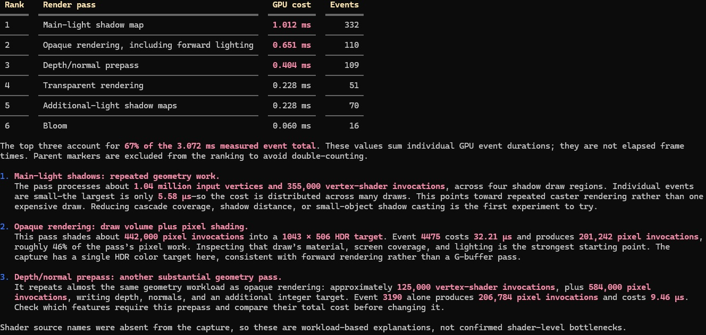

[English](README.md) | [日本語](README.ja.md)

# RenderEyeMCP


**RenderDocで開いているCaptureを、そのままAIコーディングエージェントに調べてもらう。**

RenderEyeMCPは、Claude CodeやCodexなどのAIコーディングエージェントと
[RenderDoc](https://renderdoc.org/) GUIをつなぐ
[Model Context Protocol](https://modelcontextprotocol.io/)(MCP)サーバーです。
Frameのキャプチャやリプレイは、これまでどおりRenderDocで行います(自作エンジン、Unity、
Unreal Engineからのキャプチャでも、`.rdc`ファイルを開いても構いません)。エージェントは
RenderDocが表示している内容、つまり読み込み中のCapture、選択中のEvent、Pipeline State、
Shader、Bindされたリソース、Buffer、Render Target、Pixel値を読み取ります。

RenderDocを日常的に使っているグラフィックス/エンジンプログラマーが、描画バグの調査で
エージェントに証拠集めを手伝ってもらうためのツールです。

```text
ゲームエンジン / Unity / Unreal / .rdcファイル
      |  Frameをキャプチャ
      v
RenderDoc GUI(調べたいDrawCallを選択)
      |  読み込み中のCapture + 選択中のEvent
      v
RenderEyeMCP(RenderDoc拡張 + 共有IPCサービス + MCPサーバー)
      |  MCP Tool
      v
AIコーディングエージェント  ->  根拠に基づくデバッグ支援
```

キャプチャとリプレイを担うのはあくまでRenderDocです。RenderEyeMCPは調査用の読み取り専用
ブリッジで、エージェントがCaptureを開き直す必要はなく、選択中のEventを変更することも
ありません。

## できること

Windows 11上のRenderDoc 1.46で、実際のD3D12 Captureを使って動作を確認しています。

- **RenderDocセッションの検出** — 拡張機能が読み込まれたRenderDoc GUIの一覧、各GUIで
  開いているCapture、接続状態。
- **CaptureとEvent** — Graphics API、Frame番号、Event数、ページ単位のEvent一覧、
  GUIで選択中のEvent。
- **Pipeline State** — Topology、Vertex/Index Buffer、Viewport/Scissor、Shader、
  Render Target、Depth Target、Resource Binding。
- **Shader** — Shader Reflection(入出力、Constant Buffer、リソース、Sampler)、宣言と
  実際のBindingの対応、ページ単位の逆アセンブル、埋め込みソース。
- **リソースとBuffer** — リソース一覧、Texture/Bufferのメタデータ、範囲を限定した
  Buffer読み出しと型付きデコード(Constant Bufferの値など)。
- **Render TargetとPixel** — Bindされたターゲット、TextureのPNGプレビュー、型付きの
  正確なPixel値、チャンネルごとの最小/最大値とヒストグラム。
- **複数エージェントの同時利用** — すべてのMCPクライアントが1つのバックグラウンド
  サービスを共有するため、2つのエージェントで同じRenderDocセッションを調査できます。

先に知っておいてほしい制限:

- 調査対象は常に**RenderDoc GUIで選択中のEvent**です。先にRenderDocでDrawCallや
  Dispatchを選択してください。エージェントは選択を変更できません。
- Depth/Stencilの*ステート*(比較関数、深度書き込み)、ラスタライザのCull/Fillモード、
  Blendステートは取得できません。Pixel History、Shaderデバッグ(ステップ実行)、
  メッシュ出力の確認、GPUプロファイリングは未実装です。
- 実機で検証したのはWindows上のRenderDoc 1.46とD3D12のみです。その他のAPIや
  プラットフォームは[対応プラットフォーム](#対応プラットフォーム)を参照してください。

RenderEyeMCPはRenderDocの代替でもプロファイラでもなく、バグを自動で特定するものでも
ありません。エージェントに正確なデータを渡し、解釈はあなたとエージェントが行います。

## 対応プラットフォーム

| 項目 | 状況 |
|------|------|
| Windows 11 + RenderDoc 1.46(D3D12 Capture) | 実機検証済み |
| Windows 10 | 動作する見込み。未検証 |
| Vulkan / D3D11 / OpenGL Capture | RenderDocのAPI共通インターフェース経由で動作する見込み。実機未検証 |
| Linux | CIでユニットテストは成功。RenderDocとの実機検証なし。ウィンドウのフォーカス/クローズはWindows専用 |
| macOS | 非対応(RenderDoc GUIがないため) |
| RenderDoc 1.46より前 | 非対応(拡張機能の最小バージョンが1.46) |

## 必要なもの

- RenderDoc **1.46**以上。
- MCP対応のコーディングエージェント。セットアップの自動化と動作確認は
  **Claude Code** と **Codex** で行っています。Cursor、VS Code(GitHub Copilot)、
  Gemini CLI向けの設定も生成できますが、実際のクライアントでは未確認です。
- `rendereye-mcp` の実行にPythonやその他のランタイムは不要です。RenderDoc拡張機能は
  RenderDoc内蔵のPythonインタープリターを使います。

## かんたんインストール(Windows)

1. [GitHub Releases](https://github.com/taqu/RenderEyeMCP/releases)ページから
   最新の `RenderEyeMCP-v<バージョン>-windows-amd64.zip` をダウンロードします。

2. アーカイブを恒久的なディレクトリに展開します。例: `C:\Tools\RenderEyeMCP\`

3. そのディレクトリでPowerShellを開き、インストーラーを実行します:

   ```powershell
   .\install.ps1
   ```

   インストーラーがRenderDoc拡張機能を
   `%APPDATA%\qrenderdoc\extensions\rendereye\` にコピーし、
   コーディングエージェントの設定スニペットを出力します。

4. RenderDocで **Tools → Manage Extensions** を開き、**RenderEyeMCP** を選んで
   **Always Load** を有効にします。

詳しい手順とLinuxでの注意点は[インストール](docs/ja/installation.md)を参照してください。

## コーディングエージェントの設定

### Claude Code

`~/.settings.json`(ユーザースコープ)またはプロジェクトの `.mcp.json`(プロジェクトスコープ)
に追加します。パスは `rendereye-mcp.exe` の実際の場所に置き換えてください。

```json
{
  "mcpServers": {
    "rendereye": {
      "type": "stdio",
      "command": "C:\\Tools\\RenderEyeMCP\\rendereye-mcp.exe"
    }
  }
}
```

### Codex

`~/.codex/config.toml` に追加します。

```toml
[mcp_servers.rendereye]
command = "C:\\Tools\\RenderEyeMCP\\rendereye-mcp.exe"
```

インストーラー(`install.ps1` / `install.sh`)が実際のパスに合わせたスニペットを出力します。
詳細は[設定](docs/ja/configuration.md)を参照してください。

## 使ってみる

1. RenderDocでCaptureを開きます(エンジンから、または *File → Open Capture*)。
2. Event BrowserでDrawCallを選択します。
3. エージェントに頼みます。

   > RenderDocで今開いているCaptureを調査して、選択中のDrawCallを特定し、
   > そのPipeline Stateを要約してください。

手順の詳細は[クイックスタート](docs/ja/quickstart.md)にあります。

## ドキュメント

| 内容 | English | 日本語 |
|------|---------|--------|
| インストール | [installation.md](docs/en/installation.md) | [installation.md](docs/ja/installation.md) |
| エージェントと環境の設定 | [configuration.md](docs/en/configuration.md) | [configuration.md](docs/ja/configuration.md) |
| クイックスタート | [quickstart.md](docs/en/quickstart.md) | [quickstart.md](docs/ja/quickstart.md) |
| デバッグシナリオ | [examples/](docs/en/examples/README.md) | [examples/](docs/ja/examples/README.md) |
| プロンプト例 | [prompts.md](docs/en/prompts.md) | [prompts.md](docs/ja/prompts.md) |
| MCP Toolリファレンス | [tools.md](docs/en/tools.md) | [tools.md](docs/ja/tools.md) |
| トラブルシューティング | [troubleshooting.md](docs/en/troubleshooting.md) | [troubleshooting.md](docs/ja/troubleshooting.md) |
| アーキテクチャ | [architecture.md](docs/en/architecture.md) | [architecture.md](docs/ja/architecture.md) |
| リリースガイド | [publishing.md](docs/en/publishing.md) | [publishing.md](docs/ja/publishing.md) |

## オフラインドキュメント

RenderEyeMCPのリリースパッケージには、MkDocs Materialでビルドした英語・日本語の
ドキュメントが含まれています。アーカイブを展開したら `manual/index.html` をブラウザで
開くと、ユーザーガイド、MCP Toolリファレンス、グラフィックスデバッグ事例にアクセスできます。
インターネット接続、Python、Webサーバーは一切不要です。

## 開発とビルド

RenderEyeMCPはGoで書かれています。ソースからビルドするには:

```bash
git clone https://github.com/taqu/RenderEyeMCP.git
cd RenderEyeMCP
go build ./cmd/rendereye-mcp/
go test ./...
go vet ./...
```

リリースワークフロー(`.github/workflows/release.yml`)がWindows x64とLinux x64向けの
バイナリをビルドし、アーカイブを組み立て、`v*`タグのプッシュ時にGitHub Releaseを公開します。

[CONTRIBUTING.md](CONTRIBUTING.md)を参照してください。セキュリティに関する報告は
[SECURITY.md](SECURITY.md)へ。

## ライセンス

[MIT](LICENSE)。RenderDocは独自のライセンスを持つ別プロジェクトであり、同梱していません。
