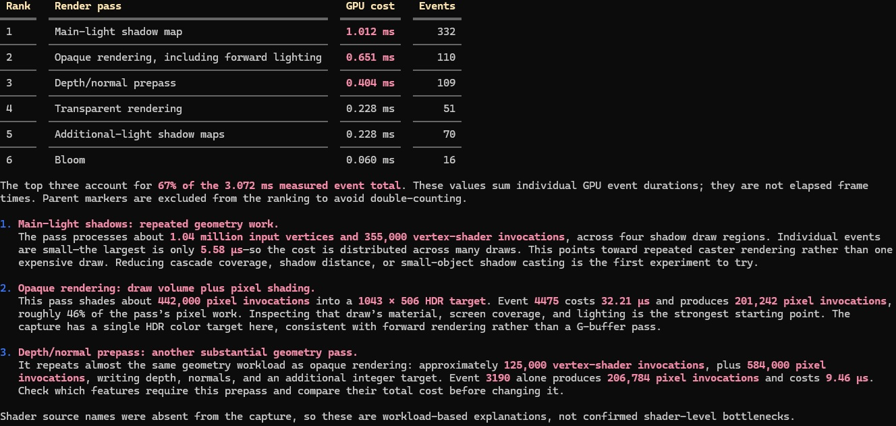

[English](README.md) | [日本語](README.ja.md)

# RenderEyeMCP


**Let your AI coding agent look at the capture you already have open in RenderDoc.**

RenderEyeMCP is a [Model Context Protocol](https://modelcontextprotocol.io/) (MCP) server
that connects AI coding agents such as Claude Code and Codex to the
[RenderDoc](https://renderdoc.org/) GUI. You keep capturing and replaying frames in
RenderDoc exactly as you do today — from your engine, from Unity or Unreal Engine, or by
opening an `.rdc` file. The agent then reads what RenderDoc is showing: the loaded capture,
the event you selected, its pipeline state, shaders, bound resources, buffers, render
targets and pixel values.

It is meant for graphics and engine programmers who already use RenderDoc and want an
agent to help gather evidence while they debug rendering problems.

```text
Game engine / Unity / Unreal / .rdc file
      |  capture a frame
      v
RenderDoc GUI  (you select the draw call you care about)
      |  loaded capture + selected event
      v
RenderEyeMCP   (RenderDoc extension + shared IPC service + MCP server)
      |  MCP tools
      v
AI coding agent  ->  evidence-based debugging assistance
```

RenderDoc stays the capture and replay application. RenderEyeMCP is a read-only bridge
for inspection: the agent does not need to reopen the capture, and it never changes which
event you have selected.

## What it can do

Verified against a real D3D12 capture in RenderDoc 1.46 on Windows 11:

- **Find your RenderDoc session** — every running RenderDoc GUI with the extension
  loaded, the capture it has open, and whether it is connected.
- **Capture and events** — API, frame number, event counts, paged event lists, and the
  event currently selected in the GUI.
- **Pipeline state** — topology, vertex/index buffers, viewports and scissors, bound
  shaders, render targets, depth target and resource bindings.
- **Shaders** — reflection (inputs, outputs, constant buffers, resources, samplers),
  declared-vs-bound resource correlation, paged disassembly, embedded source.
- **Resources and buffers** — resource lists, texture/buffer metadata, bounded buffer
  reads with optional typed decoding (e.g. constant buffer values).
- **Render targets and pixels** — bound targets, PNG previews of textures, exact typed
  pixel values, per-channel min/max and histograms.
- **Several agents at once** — all MCP clients share one background service, so two
  agents can inspect the same RenderDoc session.

Limitations to know up front:

- Inspection always uses the event **selected in the RenderDoc GUI**. Select the draw or
  dispatch in RenderDoc first; the agent cannot move the selection.
- Depth/stencil *state* (compare function, depth write), rasterizer cull/fill mode and
  blend state are not exposed. Pixel History, shader debugging/stepping, mesh output
  inspection and GPU profiling are not implemented.
- Only RenderDoc 1.46 on Windows has been validated live, with D3D12. Other APIs and
  platforms are listed in [Supported platforms](#supported-platforms).

RenderEyeMCP is not a replacement for RenderDoc, not a profiler, and it does not diagnose
bugs on its own. It gives the agent accurate data; you and the agent interpret it.

## Supported platforms

| Component | Status |
|-----------|--------|
| Windows 11 + RenderDoc 1.46 (D3D12 capture) | Validated live |
| Windows 10 | Expected to work, not validated |
| Vulkan / D3D11 / OpenGL captures | Expected to work through RenderDoc's API-neutral interface, not validated live |
| Linux | Unit tests pass in CI; no live RenderDoc validation. Window focus/close are Windows-only |
| macOS | Unsupported (no RenderDoc GUI) |
| RenderDoc older than 1.46 | Unsupported (the extension declares a 1.46 minimum) |

## Requirements

- RenderDoc **1.46** or later.
- An MCP-capable coding agent. Setup is verified for **Claude Code** and **Codex**;
  Cursor, VS Code (GitHub Copilot) and Gemini CLI configurations are generated too but
  were not verified against the real clients.
- No Python or other runtime is required to run `rendereye-mcp`. The RenderDoc extension
  uses RenderDoc's own embedded Python interpreter.

## Quick start (Windows)

1. Download the latest `RenderEyeMCP-v<version>-windows-amd64.zip` from the
   [GitHub Releases](https://github.com/taqu/RenderEyeMCP/releases) page.

2. Extract the archive to a permanent directory, for example `C:\Tools\RenderEyeMCP\`.

3. Open PowerShell in that directory and run the installer:

   ```powershell
   .\install.ps1
   ```

   The installer copies the RenderDoc extension to
   `%APPDATA%\qrenderdoc\extensions\rendereye\` and prints the coding-agent
   configuration snippet.

4. In RenderDoc open **Tools → Manage Extensions**, select **RenderEyeMCP**, and enable
   **Always Load**.

Full instructions and Linux notes: [Installation](docs/en/installation.md).

## Coding agent configuration

### Claude Code

Add to `~/.claude.json` (user scope) or `.mcp.json` in your project (project scope).
Replace the path with the actual location of `rendereye-mcp.exe`:

```json
{
  "mcpServers": {
    "rendereye": {
      "type": "stdio",
      "command": "C:\\Tools\\RenderEyeMCP\\rendereye-mcp.exe"
    }
  }
}
```

### Codex

Add to `~/.codex/config.toml`:

```toml
[mcp_servers.rendereye]
command = "C:\\Tools\\RenderEyeMCP\\rendereye-mcp.exe"
```

The installer (`install.ps1` / `install.sh`) prints the correct snippet for your path.
Full details: [Configuration](docs/en/configuration.md).

## Basic usage

1. Open a capture in RenderDoc (from your engine or with *File → Open Capture*).
2. Select a draw call in the Event Browser.
3. Ask your agent:

   > Inspect the capture currently open in RenderDoc. Identify the selected draw call and
   > summarize its pipeline state.

The step-by-step walkthrough is in the [Quick Start](docs/en/quickstart.md).

## Documentation

| Topic | English | 日本語 |
|-------|---------|--------|
| Installation | [installation.md](docs/en/installation.md) | [installation.md](docs/ja/installation.md) |
| Agent and environment configuration | [configuration.md](docs/en/configuration.md) | [configuration.md](docs/ja/configuration.md) |
| Quick start | [quickstart.md](docs/en/quickstart.md) | [quickstart.md](docs/ja/quickstart.md) |
| Debugging scenarios | [examples/](docs/en/examples/README.md) | [examples/](docs/ja/examples/README.md) |
| Prompt examples | [prompts.md](docs/en/prompts.md) | [prompts.md](docs/ja/prompts.md) |
| MCP tool reference | [tools.md](docs/en/tools.md) | [tools.md](docs/ja/tools.md) |
| Troubleshooting | [troubleshooting.md](docs/en/troubleshooting.md) | [troubleshooting.md](docs/ja/troubleshooting.md) |
| Architecture | [architecture.md](docs/en/architecture.md) | [architecture.md](docs/ja/architecture.md) |
| Release guide | [publishing.md](docs/en/publishing.md) | [publishing.md](docs/ja/publishing.md) |

## Development and building

RenderEyeMCP is written in Go. To build from source:

```bash
git clone https://github.com/taqu/RenderEyeMCP.git
cd RenderEyeMCP
go build ./cmd/rendereye-mcp/
go test ./...
go vet ./...
```

The release workflow (`.github/workflows/release.yml`) builds binaries for Windows x64
and Linux x64, assembles the archives, and publishes a GitHub Release when a `v*` tag is
pushed.

See [CONTRIBUTING.md](CONTRIBUTING.md). Security reports: [SECURITY.md](SECURITY.md).

## License

[MIT](LICENSE). RenderDoc is a separate project under its own license and is not bundled.
