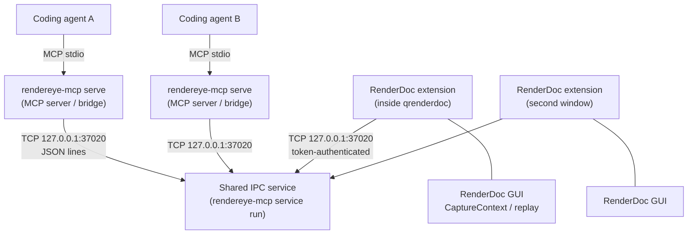

[English](architecture.md) | [日本語](../ja/architecture.md)

# Architecture

For contributors and advanced users. Protocol details are in
[IPC protocol](../ipc_protocol.md); RenderDoc API usage in
[RenderDoc integration](../renderdoc_integration.md).

## Overview



| Component | Process | Code |
|-----------|---------|------|
| MCP server (bridge) | One per agent, started by the agent: `rendereye-mcp serve` | `__main__.py`, `server.py`, `bridge/client.py` |
| Shared IPC service | One per user session, started on demand: `rendereye-mcp service run` | `service/`, `ipc/`, `captures/`, `sessions/`, `instances/` |
| RenderDoc extension | Inside each RenderDoc GUI (embedded Python, stdlib only) | `src/rendereye_mcp/_extension_data/` (mirrored in `extensions/rendereye/`) |

## Responsibilities

**MCP server (bridge).** Registers the 38 MCP tools, speaks MCP over stdio, and forwards
every tool call to the shared service as a `tool_call` message. It holds no RenderDoc
state. Logs go to stderr so stdout stays clean for MCP. Image results
(`get_texture_image`) are converted to MCP image content here.

**Shared IPC service.** The single owner of the TCP listener on `127.0.0.1:37020`.
It authenticates extensions, keeps the registry of RenderDoc GUI connections
(`ExtensionConnectionManager`), routes inspection requests to the right extension,
runs the capture-file registry and managed-session features, and executes tool calls
for all bridges (`service/tools.py`).

**RenderDoc extension.** Registered by RenderDoc through `register(version, pyrenderdoc)`.
It connects to the service, reports GUI state (capture loaded/loading, path), and
answers inspection requests by reading RenderDoc's `CaptureContext` and replay
controller. Compatible with RenderDoc's embedded Python (3.8 in RenderDoc 1.46); uses
only the standard library.

## Lifecycle

1. An agent starts `rendereye-mcp serve`. The bridge loads `.env` (via
   `RENDEREYE_ENV_FILE`) and probes the service port.
2. If no service answers, the bridge takes a startup lock
   (`%TEMP%\rendereye_mcp_startup.lock`) so only one bridge launches the service, starts
   `python -m rendereye_mcp service run` detached, and waits up to 30 s.
3. The service writes a per-run auth token to `%TEMP%\rendereye_mcp_token.txt` and a
   ready file `%TEMP%\rendereye_mcp_service.json`, then listens.
4. Each RenderDoc extension reads the token, sends `hello` and `register_instance`, then
   heartbeats every few seconds. On failure it retries with exponential back-off
   (capped at 30 s), so RenderDoc and the agents can start in any order.
5. Bridges register as `mcp_bridge` clients and send tool calls.
6. When agents exit, their bridges disconnect. The service keeps running until
   `rendereye-mcp service stop`; it never closes RenderDoc windows on shutdown.

## GUI session discovery and state synchronization

Each extension connection is one *GUI session* identified by an `instance_id` (a UUID
created when the extension registers) plus the RenderDoc process ID. The extension's
`StateObserver` samples `IsCaptureLoaded`, `IsCaptureLoading` and `GetCaptureFilename`
every 250 ms on the GUI thread and pushes `gui_state_changed` messages with an
increasing revision. `list_renderdoc_sessions` and `get_current_capture` answer from this
pushed state; they do not query RenderDoc.

When a connection drops, the session stays listed as `disconnected` with
`last_known_capture`.

## Request routing

Inspection tools (`get_selected_event`, `get_pipeline_state`, `get_texture_image`, …)
follow this path:

```text
bridge --tool_call--> service --resolve instance_id--> connection
       --inspect_capture{operation, params}--> extension
       --GUI thread: read CaptureContext / replay--> inspect_capture_result --> bridge
```

Session resolution: an explicit `instance_id`, otherwise the only connected session,
otherwise the only one with a capture loaded; else `ambiguous`. Each request has a 30 s
timeout.

## State and ownership

| State | Owner |
|-------|-------|
| Loaded capture, selected event, replay position | **RenderDoc** (the user). Agents never own it |
| GUI session registry, connection state | Shared service |
| Capture-file registry and managed sessions (SQLite) | Shared service |
| Replay operations (reads) | Extension, on RenderDoc's GUI thread |
| IPC communication | Service (server side) and extension (client side) |
| MCP request handling | Each bridge |

Inspection never calls `SetEventID` or loads captures; it reads what the user has
selected. Only `capture_open`, `session_focus` and `session_close` change GUI state, and
only for windows RenderEyeMCP launched.

## Threading

RenderDoc's `CaptureContext` must be used on the GUI thread. The extension has an IPC
worker thread and a state-observer thread; neither touches RenderDoc directly. They
submit callbacks through `Extensions().GetMiniQtHelper().InvokeOntoUIThread`
(`GUIDispatcher`), and `GUIContext` asserts it runs on that thread. Replay-controller
calls (`GetBlockingController()`, e.g. for pixel values and PNG export) are made from
those GUI-thread callbacks. All socket writes happen on the IPC worker.

## Resource and event identity

- Event IDs are RenderDoc EIDs.
- Resource IDs are RenderDoc `ResourceId` strings (`ResourceId::805`). The extension
  resolves them by matching `str(resourceId)` against the capture's resources, so they
  are only valid for the capture currently loaded in that session.
- Every inspection result carries `_capture_path` so a client can detect that the
  capture changed between calls.

## Messages and limits

- Newline-delimited JSON; protocol version 1.
- Maximum message size 16 MiB on both sides (large enough for PNG previews). An
  oversized reply is replaced by a `result_too_large` error rather than dropped.
- Per-tool limits (event pages, buffer reads, disassembly lines, pixel batches) are
  listed in the [tool reference](tools.md).

## Error handling

| Layer | Typical errors |
|-------|----------------|
| Bridge ↔ service | service start timeout; `request_failed` |
| Service | `no_renderdoc_connected`, `ambiguous`, `session_not_found`, `timeout`, `result_too_large` |
| Extension | `no_capture_loaded`, `capture_loading`, `resource_not_found`, `shader_not_bound`, `event_not_selected`, `invalid_*` |
| RenderDoc replay | `extension_error` / `unsupported` with RenderDoc's message |

## Extension installation and loading

`rendereye-mcp setup` copies the packaged files from `rendereye_mcp/_extension_data/`
to RenderDoc's per-user extension folder as `rendereye/` (`rendereye_init.py` becomes
`__init__.py`). RenderDoc discovers it through `extension.json`
(`extension_api: 1`, `minimum_renderdoc: 1.46`). The user enables it once under
**Tools → Manage Extensions** (*Always Load*). The tests enforce that
`extensions/rendereye/` and `_extension_data/` stay identical.

## Security

- The service binds to `127.0.0.1`; `0.0.0.0` is refused.
- Extensions must present the per-run token (constant-time comparison); tokens are not
  logged.
- At most 64 concurrent IPC connections.
- No shell execution or arbitrary process termination is exposed through tools.
- Not reviewed for exposure beyond the local machine; do not forward the port.
