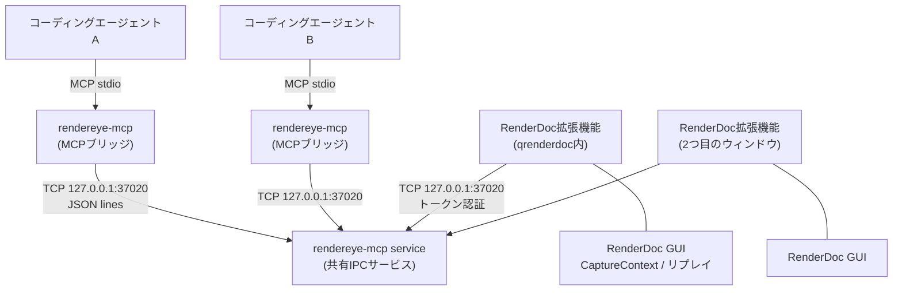

[English](../en/architecture.md) | [日本語](architecture.md)

# アーキテクチャ

コントリビューターと上級ユーザー向けです。プロトコルの詳細は
[IPCプロトコル](../ipc_protocol.md)にあります(英語)。

## 概要



| コンポーネント | プロセス | コード |
|----------------|----------|--------|
| MCPブリッジ | エージェントごとに1つ。エージェントが起動: `rendereye-mcp`(デフォルトモード) | `cmd/rendereye-mcp/`、`internal/bridge/` |
| 共有IPCサービス | ユーザーセッションごとに1つ。必要に応じて起動: `rendereye-mcp service` | `internal/server/`、`internal/lifecycle/` |
| RenderDoc拡張機能 | 各RenderDoc GUIの中(RenderDoc内蔵Python、標準ライブラリのみ) | `extensions/rendereye/` |

MCPブリッジと共有IPCサービスはどちらも同一の`rendereye-mcp`実行ファイルが提供します。
サブコマンドでモードを切り替えます。

## 役割

**MCPブリッジ。** 58個のMCP Toolを登録してstdioでMCPを話し、すべてのTool呼び出しを
`tool_call`メッセージとして共有サービスへ転送します。RenderDocの状態は持ちません。
stdoutをMCP専用に保つため、ログはstderrに出します。画像の結果(`get_texture_image`)は
ここでMCPの画像コンテンツに変換されます。

**共有IPCサービス。** `127.0.0.1:37020`のTCPリスナーを持つ唯一のプロセスです。
拡張機能を認証し、RenderDoc GUI接続の登録簿を管理し、調査リクエストを適切な拡張機能へ
振り分け、リクエストを送ったブリッジへ結果を返します。複数のブリッジが1つのサービスを
共有します。サービスはどのブリッジからも独立して動き続けます。

**RenderDoc拡張機能。** RenderDocが`register(version, pyrenderdoc)`で登録します。
サービスに接続し、GUIの状態(Captureの読み込み済み/読み込み中、パス)を報告し、
RenderDocの`CaptureContext`とリプレイコントローラーを読んで調査リクエストに答えます。
RenderDoc内蔵のPython(RenderDoc 1.46では3.8)に対応し、標準ライブラリだけを使います。
ユーザーが別途Pythonをインストールする必要はありません。

## ライフサイクル

1. エージェントが`rendereye-mcp`(MCPブリッジモード)を起動します。ブリッジは実行ファイルと
   同じフォルダーの`.env`を読み込み、サービスのポートを確認します。
2. サービスが応答しなければ、ブリッジは起動ロックを取得して1つのブリッジだけがサービスを
   起動するようにします。`rendereye-mcp service`を切り離されたバックグラウンドプロセスとして
   起動し、最大30秒待ちます。
3. サービスはマシンごとのライフサイクルロックを取得し、`127.0.0.1:37020`で待ち受けを
   始めます。
4. 各RenderDoc拡張機能は接続し、`hello`と`register_instance`を送った後、数秒ごとに
   ハートビートを送ります。失敗すると指数バックオフ(上限30秒)で再試行するため、
   RenderDocとエージェントはどちらが先に起動しても構いません。
5. ブリッジは`mcp_bridge`クライアントとして登録し、Tool呼び出しを送ります。
6. エージェントが終了するとブリッジは切断します。サービスはマシンを再起動するかプロセスを
   強制終了するまで動き続けます。終了時にRenderDocのウィンドウを閉じることはありません。

## GUIセッションの検出と状態の同期

拡張機能の接続1つが1つの*GUIセッション*です。拡張機能の登録時に作られるUUIDの
`instance_id`と、RenderDocのプロセスIDで識別します。拡張機能の`StateObserver`は
GUIスレッド上で250 msごとに`IsCaptureLoaded`、`IsCaptureLoading`、
`GetCaptureFilename`をサンプリングし、増加するリビジョン番号付きで
`gui_state_changed`メッセージを送ります。`list_renderdoc_sessions`と
`get_current_capture`は、この送られてきた状態から答えます。RenderDocへの問い合わせは
しません。

接続が切れても、そのセッションは`last_known_capture`付きの`disconnected`として残ります。

## リクエストの振り分け

調査用のTool(`get_selected_event`、`get_pipeline_state`、`get_texture_image`など)は
次の経路をたどります。

```text
ブリッジ --tool_call--> サービス --instance_idを解決--> 接続
       --inspect_capture{operation, params}--> 拡張機能
       --GUIスレッド: CaptureContext / リプレイを読む--> inspect_capture_result --> ブリッジ
```

セッションの解決順: 明示された`instance_id`、なければ唯一の接続中セッション、なければ
Captureを読み込んでいる唯一のセッション。いずれでもなければ`ambiguous`です。各リクエストの
タイムアウトは30秒です。

## 状態と所有者

| 状態 | 所有者 |
|------|--------|
| 読み込み中のCapture、選択中のEvent、リプレイ位置 | **RenderDoc**(ユーザー)。エージェントが所有することはない |
| GUIセッションの登録簿、接続状態 | 共有IPCサービス |
| リプレイ操作(読み取り) | 拡張機能。RenderDocのGUIスレッド上で実行 |
| IPC通信 | サービス(サーバー側)と拡張機能(クライアント側) |
| MCPリクエストの処理 | 各MCPブリッジ |

調査処理が`SetEventID`を呼んだりCaptureを読み込んだりすることはありません。ユーザーが
選択したものを読むだけです。GUIの状態を変えるのは`capture_open`、`session_focus`、
`session_close`だけで、対象はRenderEyeMCPが起動したウィンドウに限られます。

## スレッド

RenderDocの`CaptureContext`はGUIスレッドで使う必要があります。拡張機能にはIPCワーカー
スレッドと状態監視スレッドがありますが、どちらもRenderDocに直接は触れません。
`Extensions().GetMiniQtHelper().InvokeOntoUIThread`(`GUIDispatcher`)経由でコールバックを
投げ、`GUIContext`はそのスレッドで実行されていることを検査します。リプレイコントローラーの
呼び出し(`GetBlockingController()`。Pixel値やPNG出力など)も、これらのGUIスレッド上の
コールバックから行います。ソケットへの書き込みはすべてIPCワーカーが行います。

## リソースとEventの識別

- Event IDはRenderDocのEIDです。
- リソースIDはRenderDocの`ResourceId`の文字列(`ResourceId::805`)です。拡張機能は
  `str(resourceId)`をCapture内のリソースと照合して解決するため、そのセッションで今
  読み込まれているCaptureの中でのみ有効です。
- すべての調査結果に`_capture_path`が含まれるので、呼び出しの間にCaptureが変わったことを
  クライアント側で検出できます。

## メッセージと上限

- 改行区切りのJSON。プロトコルバージョン1。
- メッセージの最大サイズは両側とも16 MiB(PNGプレビューに十分な大きさ)。上限を超える
  応答は、破棄されるのではなく`result_too_large`エラーに置き換えられます。
- Toolごとの上限(Eventのページ、Buffer読み出し、逆アセンブルの行数、Pixelのバッチ)は
  [Toolリファレンス](tools.md)にあります。

## エラー処理

| レイヤー | 主なエラー |
|----------|------------|
| ブリッジ ↔ サービス | サービス起動のタイムアウト、`request_failed` |
| サービス | `no_renderdoc_connected`、`ambiguous`、`session_not_found`、`timeout`、`result_too_large` |
| 拡張機能 | `no_capture_loaded`、`capture_loading`、`resource_not_found`、`shader_not_bound`、`event_not_selected`、`invalid_*` |
| RenderDocのリプレイ | RenderDocのメッセージ付きの`extension_error` / `unsupported` |

## 拡張機能のインストールと読み込み

インストーラーはリリースアーカイブの`extension/`ディレクトリをRenderDocのプラグイン
フォルダーへ`rendereye/`としてコピーします。RenderDocは`extension.json`
(`extension_api: 1`、`minimum_renderdoc: 1.46`)によって拡張機能を見つけます。ユーザーは
一度だけ**Tools → Manage Extensions**で有効にします(*Always Load*)。

## セキュリティ

- サービスは`127.0.0.1`にバインドします。`0.0.0.0`は拒否されます。
- 拡張機能は起動ごとのトークンを提示する必要があります(定数時間比較)。トークンは
  ログに出しません。
- IPCの同時接続は最大64。
- シェル実行や任意のプロセス終了をToolとして公開していません。
- ローカルマシン外への公開についてはレビューしていません。ポートを転送しないでください。
